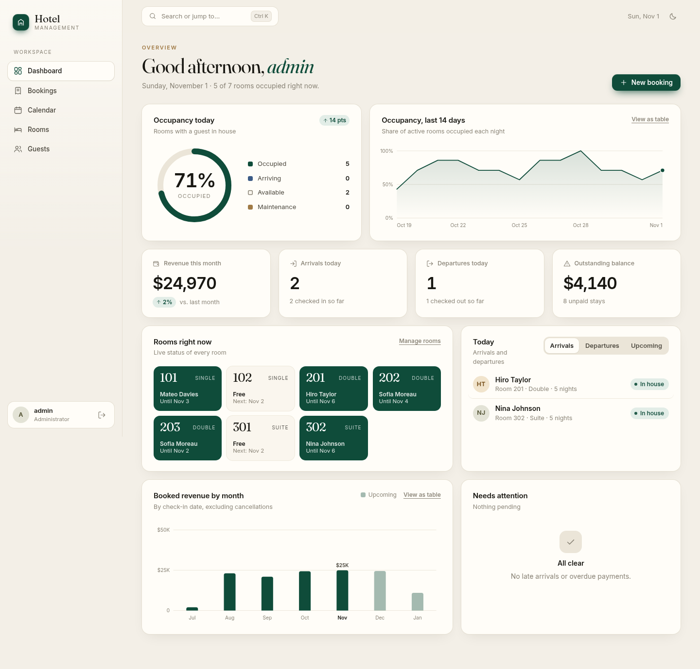
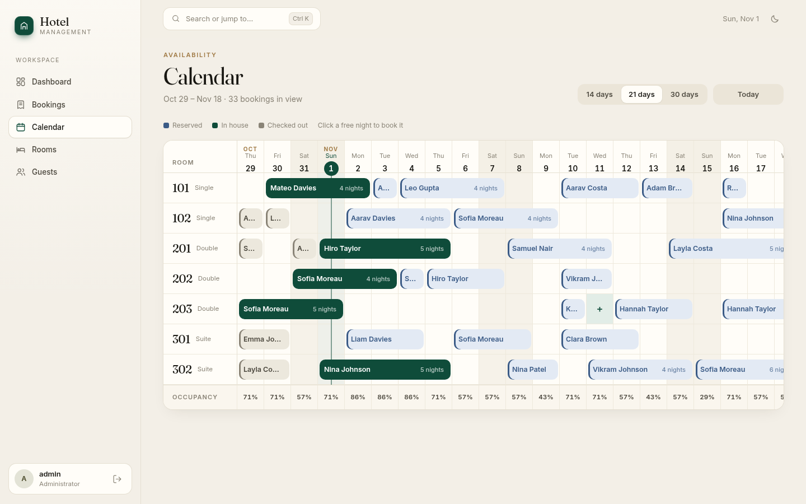
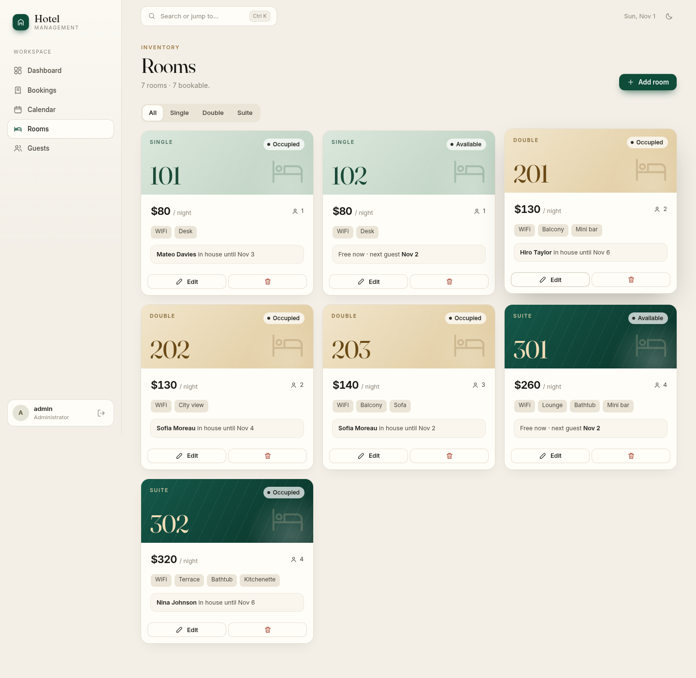
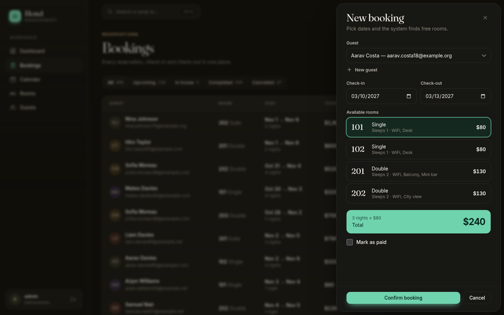
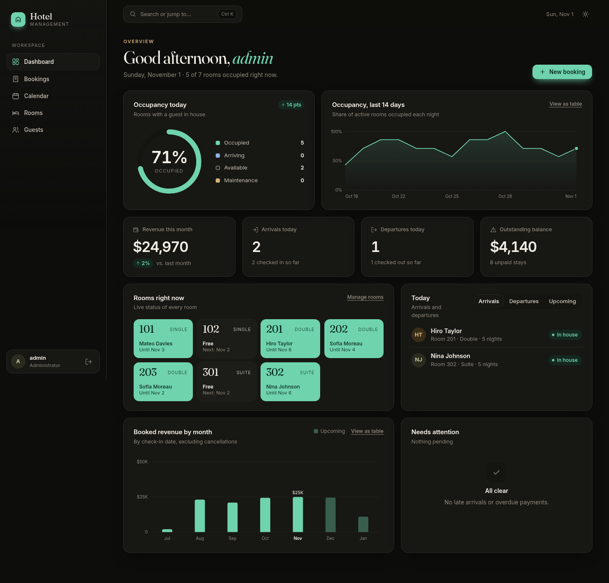

# Hotel Management System

A full-stack web application for running a small hotel: rooms, guests, reservations, check-in/out, payments and live occupancy, in one calm workspace. Double-bookings are prevented at the database level, and the booking workflow replaces manual tracking.

**Live demo:**  https://hotel-management-project-j5u2.onrender.com/



<p>
  
  
</p>
<p>
  
  
</p>

## Features

- **Dashboard**: occupancy ring and 14-day trend, revenue by month, arrivals and departures, a live room board, and a "needs attention" list (late arrivals, overdue payments). Charts have hover tooltips and a table view.
- **Bookings**: filter by status, search, quick check-in/out, a detail drawer with receipt and timeline, and payment tracking.
- **Calendar**: a Gantt-style timeline of every room. Click a bar for details or a free night to start a booking with the room and date pre-filled.
- **Rooms and guests**: full CRUD, with per-guest booking history and lifetime totals.
- **Booking automation**:
  - Overlap check inside a database transaction, so two people cannot book the same room for the same night, even simultaneously.
  - Total price calculated server-side from nights x rate.
  - Enforced status workflow: reserved -> checked in -> checked out, or cancelled. Illegal transitions are rejected.
  - Availability search that only offers rooms free for the whole stay.
- **Security**: bcrypt-hashed passwords, JWT in an httpOnly cookie, rate-limited login, Helmet headers, parameterized SQL, schema validation with Zod, and HTML-escaped rendering.
- **UX**: light and dark themes, a Ctrl+K command palette, responsive layout with a mobile tab bar, keyboard navigation, and reduced-motion support.

## Tech stack

| Layer | Technology |
|---|---|
| Frontend | Vanilla JavaScript (ES modules), CSS, no build step. Inline SVG charts. |
| Backend | Node.js 20+, Express 5 |
| Database | MySQL-compatible (TiDB Cloud Serverless in production), `mysql2` with raw SQL |
| Auth and validation | `jsonwebtoken`, `bcryptjs`, `zod`, `helmet`, `express-rate-limit` |
| Hosting | Render (app) + TiDB Cloud (database), both on free tiers |

## Project structure

```
.
├── server/
│   ├── app.js                 Express app, middleware, routing, static files
│   ├── db/
│   │   ├── pool.js            MySQL pool (TLS when DB_SSL=true)
│   │   └── schema.sql         Tables and indexes
│   ├── routes/                auth, rooms, guests, bookings, dashboard
│   ├── middleware/auth.js     JWT cookie check
│   ├── util/                  date helpers, room-state lookup
│   └── scripts/
│       ├── setup.js           Creates tables, admin user, sample rooms
│       └── seed-demo.js       Optional realistic demo guests and bookings
├── public/
│   ├── index.html
│   ├── css/app.css            Design system (tokens, components, themes)
│   └── js/
│       ├── main.js            Shell, router, login, command palette
│       ├── lib/               html templating, api, ui, charts, drawers, icons
│       └── views/             dashboard, bookings, calendar, rooms, guests
├── docs/screenshots/
└── .env.example
```

## Run locally

### 1. Prerequisites
- Node.js 20 or newer
- A MySQL-compatible database. Either a free [TiDB Cloud](https://tidbcloud.com) Starter cluster (the same one you will use in production) or a local MySQL, for example:
  ```bash
  docker run -d --name hotel-mysql -p 3306:3306 \
    -e MYSQL_ROOT_PASSWORD=devpass -e MYSQL_DATABASE=hotel mysql:8
  ```

### 2. Install and configure
```bash
npm install
cp .env.example .env     # then edit the values
```

| Variable | Description |
|---|---|
| `PORT` | App port (default 3000) |
| `NODE_ENV` | `development` or `production` (production enables secure cookies) |
| `JWT_SECRET` | Long random string. Generate with `openssl rand -hex 32` |
| `DB_HOST`, `DB_PORT`, `DB_USER`, `DB_PASSWORD`, `DB_NAME` | Database connection. TiDB uses port `4000` |
| `DB_SSL` | `true` for TiDB Cloud, `false` for a local MySQL |
| `ADMIN_USERNAME`, `ADMIN_PASSWORD` | Admin login created by `npm run setup` |
| `HOTEL_TZ` | Optional IANA timezone, such as `Asia/Kolkata`, so "today" matches your hotel (default `UTC`) |

### 3. Create the schema and start
```bash
npm run setup        # creates tables, the admin user and 7 sample rooms (safe to re-run)
npm run seed-demo    # optional: ~40 fictional guests and ~300 bookings around today
npm run dev          # http://localhost:3000, restarts on file changes
```
Log in with the `ADMIN_USERNAME` and `ADMIN_PASSWORD` you set.

`npm run seed-demo` refuses to run if guests already exist unless you pass `--force`.

## Deployment (Render + TiDB Cloud, free)

The app is a single Node service that serves both the API and the frontend, so there is one thing to deploy. Data lives in TiDB, because Render's free filesystem is ephemeral.

### Step 1: Push to GitHub
```bash
git init && git add . && git commit -m "Hotel management system"
git branch -M main
git remote add origin https://github.com/<you>/hotel-management-system.git
git push -u origin main
```
`.env` is git-ignored. Confirm with `git status` that it is not staged.

### Step 2: Create the TiDB database
1. Sign up at [tidbcloud.com](https://tidbcloud.com) and create a **Starter** (free) cluster. Pick a region near your Render region.
2. In the cluster's **SQL Editor**, run `CREATE DATABASE hotel;`
3. Click **Connect**, choose the **public endpoint** and **General**, then **Generate Password**. Note the host, port (`4000`), username (it has a prefix such as `abc123.root`) and password.

No CA certificate file is needed. TiDB Starter uses a publicly trusted certificate, and the app verifies it when `DB_SSL=true`.

### Step 3: Create the Render web service
On [render.com](https://render.com), choose **New -> Web Service**, connect the repo and use:

| Setting | Value |
|---|---|
| Runtime | Node |
| Build command | `npm install && npm run setup` |
| Start command | `npm start` |
| Instance type | Free |
| Health check path | `/healthz` |

Add these environment variables:

```
NODE_ENV=production
JWT_SECRET=<long random string>
DB_HOST=<TiDB host>
DB_PORT=4000
DB_USER=<TiDB user>
DB_PASSWORD=<TiDB password>
DB_NAME=hotel
DB_SSL=true
ADMIN_USERNAME=admin
ADMIN_PASSWORD=<strong password>
HOTEL_TZ=<your timezone, e.g. Asia/Kolkata>
```

The build command runs `npm run setup` on every deploy. It is idempotent: tables use `IF NOT EXISTS`, sample rooms are only inserted into an empty table, and the admin password is re-applied from `ADMIN_PASSWORD`. To rotate the admin password, change that variable and redeploy.

### Step 4: Verify
1. Open `https://hotel-management-project-j5u2.onrender.com/` and log in.
2. Create a guest and a booking, then try an overlapping booking. It should be refused.
3. Optionally load demo data once from your machine, with your `.env` pointing at TiDB: `npm run seed-demo`.

### Step 5: Keep it awake (optional)
Render's free tier spins a service down after 15 minutes without traffic, and the next request takes up to about a minute. A free uptime monitor such as UptimeRobot pinging `https://<your-service>.onrender.com/healthz` every 5 minutes prevents this.

### Redeploying
Every `git push` to `main` redeploys automatically.

### Troubleshooting

| Symptom | Likely cause |
|---|---|
| Build fails at setup with `ECONNREFUSED` or a timeout | Wrong host, or port is not `4000` |
| `Access denied for user` | Username is missing its TiDB prefix (`abc123.root`), or the password is wrong |
| SSL or certificate error | `DB_SSL` is not exactly `true` |
| Logged out on every request in production | Visiting over plain `http`. Production cookies are `Secure`, so use the `https` URL |
| First load is slow | Free instance waking from sleep (see Step 5) |
| Local UI shows old data | An old server is still holding port 3000. Run `ss -ltnp \| grep 3000` and stop it |

## Design notes

- **Concurrency on TiDB.** The booking transaction locks the room row with `SELECT ... FOR UPDATE`. On TiDB, plain reads inside a transaction see a snapshot from the start of the transaction, so a waiting request could miss a booking that had just been committed. The overlap check is therefore also a locking read (`FOR UPDATE`), which reads the latest data. Tested with six simultaneous requests for the same room and dates: exactly one succeeds.
- **Latency to a hosted database.** The dashboard needs about ten independent queries. They run in parallel and the pool is warmed at startup, which brought the endpoint from about 2.6 s to about 0.3 s.
- **No build step.** The frontend is plain ES modules with a small tagged-template helper that escapes every interpolated value by default.

## API overview

All routes except `/api/auth/login` require the session cookie.

```
POST   /api/auth/login | /api/auth/logout        GET /api/auth/me
GET    /api/rooms                                rooms with current and next booking
GET    /api/rooms/available?from=&to=&type=      rooms free for the whole stay
POST   /api/rooms        PUT/DELETE /api/rooms/:id
GET    /api/guests?q=    POST /api/guests        PUT/DELETE /api/guests/:id
GET    /api/bookings?status=&from=&to=&guest_id= GET /api/bookings/:id
POST   /api/bookings                             overlap-safe, transactional
PATCH  /api/bookings/:id/status                  reserved|checked_in|checked_out|cancelled
PATCH  /api/bookings/:id/paid
GET    /api/dashboard/stats
GET    /healthz
```

## Notes

- There is a single admin account. Multi-user roles would be a natural extension.
- Payments are tracked as paid or unpaid. No payment gateway is integrated.
- Demo data uses fictional names and `example.com` addresses.
